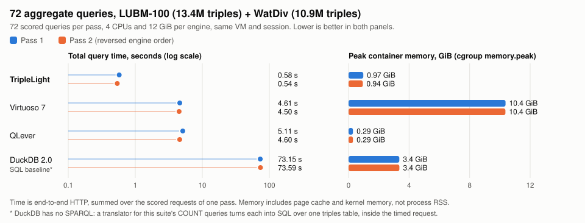

# TripleLight

**An embedded, analytical RDF database with SPARQL 1.1, written in Rust.**

TripleLight is aimed at RDF analytics the way DuckDB is aimed at tables: aggregates, GROUP BY, DISTINCT and
large joins over millions to hundreds of millions of triples. You can use it as:

- a **library** inside your Rust or Python program, with no server to run, or
- a **SPARQL 1.1 HTTP server**, an optional feature for tools that need one.

Data lives in memory or in a persistent on-disk store with a write-ahead log. Benchmark answers are checked
against Apache Jena, and SPARQL features TripleLight does not implement are rejected with an "unsupported" error
instead of returning a partial result.

> **Status: early (0.1).** There are no published releases yet; build from source. The on-disk format and APIs may still
> change. Unix only (Linux, macOS), Rust 1.89+.

## In-memory databases

For short-lived embedded workloads, `Database::in_memory()` (Rust), `Database.in_memory()` (Python), and `Database.inMemory()` (Node.js) create an isolated database without a database directory or a write-ahead log. Data disappears when the last handle is dropped. `load` imports N-Triples or Turtle; importing into an empty in-memory database builds its indexes in bulk. Updates and read snapshots are supported. Compaction rebuilds the in-memory indexes without writing a database file. Imported blank-node labels are scoped to each source document in both in-memory and persistent stores. Import, compaction and query results can consume substantial RAM.

## Quickstart

### Command line

```sh
git clone https://github.com/odysa/triplelight.git triplelight && cd triplelight
cargo build --release            # binary: ./target/release/triplelight

# Ask a question of an N-Triples or Turtle file
./target/release/triplelight query data.nt 'SELECT (COUNT(*) AS ?n) WHERE { ?s ?p ?o }'

```

### Optional: SPARQL HTTP server

TripleLight is an embedded library first. The HTTP server is an optional Cargo feature:

```sh
cargo build --release --features server

# Serve a file over the SPARQL 1.1 protocol at http://127.0.0.1:7878/sparql (read-only)
./target/release/triplelight serve data.nt 7878

# Persistent store, created from data.nt on first start; SPARQL Update at /update with a token
TRIPLELIGHT_UPDATE_TOKEN=change-me ./target/release/triplelight serve-store ./store 7878 --disk --init data.nt
```

The server listens on 127.0.0.1 unless `TRIPLELIGHT_HOST` is set. `serve-store` accepts updates only when
`TRIPLELIGHT_UPDATE_TOKEN` is set (clients then send `Authorization: Bearer <token>`); otherwise `/update` is
disabled. For local scripts you can pass `--allow-unauthenticated-updates` instead; it works only on 127.0.0.1 and
still refuses requests from browser pages. The token travels in plain HTTP, so on an untrusted network put the server behind a
TLS-terminating proxy.

Query the server with any SPARQL client, for example:

```sh
curl -s http://127.0.0.1:7878/sparql --data-urlencode 'query=SELECT * WHERE { ?s ?p ?o } LIMIT 5'
```

### Python

```sh
python3 -m venv .venv && source .venv/bin/activate    # maturin develop needs an active virtualenv
pip install maturin
cd bindings/python && maturin develop --release
```

```python
import triplelight

db = triplelight.Database("my.db")                  # opens or creates a store in this directory
db.update('INSERT DATA { <urn:alice> <urn:age> 30 . <urn:bob> <urn:age> 41 }')
db.load("more-data.nt")                             # bulk import N-Triples or Turtle

for row in db.query("SELECT ?who ?age WHERE { ?who <urn:age> ?age } ORDER BY ?age"):
    print(row["who"], row["age"])                   # IRIs, ints, strings come back as Python values
```

Updates are atomic and durable (fsync before `update` returns). `db.read()` gives a consistent snapshot for several
queries. See [bindings/python](bindings/python).

### Rust

```toml
[dependencies]
triplelight = { git = "https://github.com/odysa/triplelight" }
```

```rust
use triplelight::embedded::Database;
use triplelight::exec::QueryResult;

let db = Database::open("./example.db")?;
db.update("INSERT DATA { <https://ex/s> <https://ex/p> <https://ex/o> }")?;
match db.read().query("ASK { <https://ex/s> <https://ex/p> <https://ex/o> }")? {
    QueryResult::Boolean(found) => assert!(found),
    _ => unreachable!(),
}
```

More in [docs/embedded/README.md](docs/embedded/README.md), including bulk loading of large files with
`triplelight build-disk`.

## Performance

Benchmarks compare like with like: **embedded engines in the same process** (no network on any side), and
**servers over HTTP**. The two kinds of numbers are never mixed in one table.

### Embedded (in-process): Python API

Each engine runs inside one Python process through its own API and its own on-disk store, in a container capped at
4 CPUs and 12 GiB. Times are summed query seconds per pass, from submitting the query until the full result has been
converted to Python values. Two passes (pass 2 in reversed order). BI: 15 warm-up then 45 timed requests per pass;
each aggregate phase: one complete warm pass, then one timed pass. **Lower is better.**

| Workload | TripleLight | DuckDB (SQL baseline) | pyoxigraph |
|---|---:|---:|---:|
| BSBM BI, 10M triples (45 timed requests) | **11.6 / 13.1 s** | 130.0 / 110.6 s | not ranked: qualification incomplete |
| LUBM-100 aggregates (30 queries) | **0.67 / 0.64 s** | 50.4 / 40.0 s | 41.7 / 34.5 s |
| WatDiv aggregates (42 queries) | **0.20 / 0.23 s** | 27.1 / 18.9 s | 71.6 / 71.8 s |

All 1,104 scheduled requests passed the frozen answer gates against Apache Jena, with no retries or out-of-memory
failures. The gates are: BI value-compatible (registered numeric tolerance, exact anchors, ORDER BY rules), and for
the aggregates COUNT-compatible with exact group terms and multiplicity. They are not exact typed-result equality on
every query. TripleLight ran at commit `e2e9cb2f`. Engine cache settings differ between engines. DuckDB has no SPARQL;
it answers SQL over one triples table: hand-written templates for BSBM BI, and a translator written only for the
aggregate suite for LUBM and WatDiv (generation inside the timer). pyoxigraph has no BI total because its BI
qualification timed out before completing (the 11 answers it produced passed); separately, in a nine-term identity
test it merges literals that RDF treats as distinct terms. Evidence:
[report and raw answers]((internal link removed)).

### Embedded (in-process): Node.js API

The same workloads, gates and container limits, with each engine running inside one Node.js process (Node 24, Linux
ARM64). The timer runs from submitting the query until the full result has been converted to JavaScript term
objects. Summed query seconds, pass 1 / pass 2. **Lower is better.**

On-disk engines:

| Workload | TripleLight | quadstore + Comunica |
|---|---:|---:|
| BSBM BI, 10M triples (45 timed requests) | **8.49 / 9.94 s** | no total: incomplete, and collected answers failed gates |
| LUBM-100 aggregates (30 queries) | **0.65 / 0.75 s** | no total: qualification incomplete |
| WatDiv aggregates (42 queries) | **0.21 / 0.26 s** | 322.9 / 543.6 s |

In-memory engine, a separate storage group (the whole graph is loaded into memory before timing; not ranked against
the on-disk engines):

| Workload | oxigraph JS |
|---|---:|
| BSBM BI, 10M triples | no total: qualification incomplete |
| LUBM-100 aggregates (30 queries) | 16.4 / 16.2 s |
| WatDiv aggregates (42 queries) | 76.4 / 74.7 s |

All 864 scheduled requests passed the frozen answer gates against Apache Jena. TripleLight ran at commit `2bd070ae`.
oxigraph's JS API does not report result columns, so the adapter takes them from the reference answers; that does
not independently verify the projection of empty results. A first scored attempt stopped when quadstore WatDiv hit a 900-second whole-phase cap (which
includes opening the store); the cap was raised to 1,800 seconds, registered before the second attempt, and the two
attempts are not mixed. Missing totals mean an engine did not finish qualification, not a zero or a measured loss.
Evidence: [report and raw answers]((internal link removed)).

### Embedded in-memory (Python API)

Each engine loads the N-Triples file into a fresh in-memory store inside its own container (TripleLight through
`Database.in_memory()`, pyoxigraph through a pathless `Store()`, DuckDB through `:memory:`), then runs the same frozen
workloads and answer checks. Summed query seconds, pass 1 / pass 2. **Lower is better.**

| Workload | TripleLight in-memory | pyoxigraph in-memory | DuckDB in-memory (SQL baseline) |
|---|---:|---:|---:|
| LUBM-100 aggregates (30 timed requests) | **0.51 / 0.43 s** | 9.2 / 6.6 s | 23.4 / 19.6 s |
| WatDiv aggregates (42 timed requests) | **0.26 / 0.20 s** | 114.7 / 45.5 s | 13.4 / 11.6 s |
| BSBM BI, 10M triples (45 timed requests) | **18.9 / 17.4 s** | no total: qualification incomplete | 29.3 / 29.5 s |

All 1,104 scheduled requests passed the frozen answer gates against Apache Jena. Loading is outside the query timer.
TripleLight's whole-phase memory peak was higher (up to 9.3 GiB, against 7.7 GiB for pyoxigraph and about 4–5 GiB for
DuckDB, which is internally limited to 8 GB while the others have no internal ceiling). DuckDB answers SQL over one
triples table, with SQL generation inside the timer. pyoxigraph's two WatDiv passes differ by 2.5×; both are kept. This
group is separate from the Node in-memory, on-disk Python and HTTP tables. Evidence:
[report and raw answers]((internal link removed)).

### Embedded in-memory (Node.js API)

Both engines load the N-Triples file into a fresh in-memory store inside each container (TripleLight through
`Database.inMemory()` and its native Node binding, oxigraph JS through its WASM package), then run the same frozen
workloads and answer checks. Summed query seconds, pass 1 / pass 2. **Lower is better.**

| Workload | TripleLight in-memory | oxigraph JS (WASM) |
|---|---:|---:|
| LUBM-100 aggregates (30 timed requests) | **0.69 / 0.50 s** | 14.1 / 14.7 s |
| WatDiv aggregates (42 timed requests) | **0.19 / 0.29 s** | 83.6 / 77.9 s |
| BSBM BI, 10M triples (45 timed requests) | 14.3 / 13.3 s (standalone) | no total: qualification incomplete |

All 696 scheduled requests passed the frozen answer gates against Apache Jena. Loading is outside the query timer.
The trade-off is memory: TripleLight's whole-phase peak reached 8.1 / 9.4 GiB on LUBM against oxigraph's 4.1 / 4.0 GiB.
This group is separate from the on-disk Node table above: different storage, source commit (`fd204cec`) and session,
so it does not measure in-memory against on-disk TripleLight. Evidence:
[report and raw answers]((internal link removed)).

### Embedded JVM baselines (Java API, no TripleLight row)

TripleLight has no Java binding yet, so this section measures Jena and RDF4J on the same frozen workloads and answer
checks, as reference points only; it does not rank TripleLight against them. Summed query seconds, pass 1 / pass 2.
**Lower is better.**

| Workload | Jena TDB2 (disk) | RDF4J NativeStore (disk) | RDF4J LMDBStore (disk) | RDF4J MemoryStore (in memory) |
|---|---:|---:|---:|---:|
| LUBM-100 aggregates (30 timed requests) | 9.5 / 18.8 s | 9.8 / 14.6 s | 6.6 / 13.8 s | 1.9 / 3.4 s |
| WatDiv aggregates (42 timed requests) | 20.6 / 39.8 s | 1.3 / 2.7 s | 1.4 / 1.5 s | 0.50 / 0.56 s |
| BSBM BI, 10M triples (45 timed requests) | 148.8 / 188.8 s (standalone) | excluded | excluded | excluded |

All 1,272 scheduled requests passed the frozen answer gates. RDF4J's three backends are excluded from BI because they
disagree with Jena on query q5 (an unbound GROUP BY key in a join). Each answer was validated before the next request,
so requests are not back to back as in the Python and Node tables. Evidence:
[report and raw answers]((internal link removed)).

### Embedded HDT baseline (Java API, separate session, no TripleLight row)

HDT 3.0.10 is a compressed, read-only triple store queried through Jena 4.3.2's engine. It was measured on its own, in a
separate session from the JVM table above, under the same frozen workloads, answer checks and JVM limits. Summed query
seconds, pass 1 / pass 2. **Lower is better.**

| Workload | HDT 3.0.10 / Jena 4.3.2 |
|---|---:|
| LUBM-100 aggregates (30 timed requests) | 9.3 / 9.8 s |
| WatDiv aggregates (42 timed requests) | 11.4 / 14.5 s |
| BSBM BI, 10M triples (45 timed requests) | 164.7 / 171.3 s |

All 408 scheduled requests passed the frozen answer gates. Each phase opens a pre-built HDT store; building it is not
timed. This is not a same-session comparison with Jena TDB2 6.2.0, and like the JVM table it does not rank TripleLight.
Evidence: [report and raw answers]((internal link removed)).

### Server (HTTP)

Two analytical workloads, each measured in its own session on one Linux VM, with every engine capped at 4 CPUs and
12 GiB. They were not measured together on one build: BI used TripleLight commit `ef7a778` and the aggregate suite
`9a2f49b`.
Left: total query time in **seconds, log scale**. Right: peak container memory in **GiB**. **Lower is better** in
both. Each engine ran two passes (pass 2 in reversed order); both are shown because timings drift between passes.

<picture>
  <source media="(prefers-color-scheme: dark)" srcset="docs/images/bench-bi100m-dark.svg">
  
</picture>

<picture>
  <source media="(prefers-color-scheme: dark)" srcset="docs/images/bench-aggregate72-dark.svg">
  
</picture>

| Workload | What is timed | Answers checked |
|---|---|---|
| **BSBM BI, 98.9M triples** | 45 requests per pass over 8 query templates, end-to-end HTTP | Against Jena; all engines pass a value-only check, TripleLight and DuckDB also pass the datatype check on 60/60 |
| **Aggregate72** (LUBM-100 13.4M + WatDiv 10.9M triples) | 72 COUNT / GROUP BY / DISTINCT queries per pass, end-to-end HTTP | Against Jena; all engines pass with COUNT `xsd:int` accepted as `xsd:integer` |

**What this shows, honestly:**

- TripleLight is the fastest of these engines on both workloads in total time: about 2–4× QLever on BI at 98.9M
  triples, and about 8–9× QLever and Virtuoso on the aggregate suite.
- **QLever uses much less memory** (about a tenth of TripleLight's on BI 100M) and is faster on one BI query
  template (q3). Memory and q3 are our main open gaps.
- On WatDiv alone, TripleLight and Virtuoso are close (0.26 / 0.23 s vs 0.30 / 0.31 s).
- **DuckDB does not support RDF or SPARQL**, so it is a SQL baseline here, not an RDF engine. The triples are loaded
  into one DuckDB table (subject, predicate, and object with its datatype and language). For BSBM BI, each request
  fills a hand-written SQL template for its query template; for the aggregate suite, a small translator written for
  that suite turns each SPARQL COUNT query into SQL. In both cases the SQL generation runs inside the timed request.
  A better SQL layout (integer IDs, one table per predicate) would likely be much faster and has not been measured.
- Two passes on a shared machine is a bounded observation, not a significance test.

Full tables, per-query breakdowns, more datasets (LUBM-1000, BSBM, WatDiv), other engines (Jena, RDF4J,
Oxigraph, Virtuoso, LadybugDB), methodology and raw evidence: **[docs/benchmarks.md](docs/benchmarks.md)**.
The charts are generated by [bench/charts.py](bench/charts.py) from the published evidence.
A separate [Ladybug schema study](docs/ladybug-hybrid-explore-v1/README.md) shows why mapping matters:
a hybrid schema cuts query-to-full-JSON totals by 4.41× / 4.39× on 20 fixed BSBM Explore instances, at the cost of
a 58.9% larger database and about 25.6% higher worker peak RSS. It is a warm-cache comparison within Ladybug;
it does not replace the historical cross-engine timings. Gains vary: four nested-OPTIONAL instances improve about 1.3×, while the largest gains are around 20×.

The separate [Virtuoso100M correctness screen](docs/virtuoso100-qualification-v1/README.md) fails the required all-60 answer gate
(42/60 primary, 59/60 value-compatible), so it adds no timing comparison.

## Features

- **SPARQL 1.1 query and update**: SELECT, ASK, CONSTRUCT, OPTIONAL, UNION, MINUS, FILTER, EXISTS, subqueries,
  VALUES, BIND, GROUP BY with all standard aggregates, ORDER BY, LIMIT/OFFSET, `INSERT DATA`, `DELETE DATA`,
  `DELETE/INSERT WHERE`.
- **Exact numbers, within a range**: `xsd:decimal` arithmetic is exact within 96 bits and 28 fractional digits, and
  `xsd:integer` within 64 bits; results outside that range are query errors (Jena uses arbitrary precision).
  Non-terminating decimal quotients such as 1/3 are rounded to 28 digits. Decimal underflow is an error, which is
  stricter than XPath (XPath returns 0.0), so numeric behavior is not fully SPARQL-conformant.
- **Storage**: dictionary-encoded 64-bit term IDs, six sorted triple orders, compressed and checksummed blocks
  with a shared cache, write-ahead log with group commit, snapshot reads, and compaction.
- **Query engine**: cost-based join ordering from statistics, worst-case-optimal (leapfrog) and bind joins,
  filter pushdown, hash aggregation and top-k on term IDs.
- **W3C SPARQL 1.1 test suite**: 281 pass, 6 fail, 44 unsupported ([details](bench/results/w3c-sparql11)).

### Not supported yet

- Property paths, named graphs (`GRAPH`, `FROM`, N-Quads/TriG), `SERVICE`, `DESCRIBE`, and some functions (hashes, `NOW`,
  `UUID`, …). These return an "unsupported" error.
- Results are fully materialized in memory; there is no streaming or Arrow output yet.
- One process per store directory (enforced by a file lock).
- Opening a large store takes seconds until optimizer statistics are ready (42.8 s for a 100M-triple store);
  queries work before that with simpler plans.

## Learn more

- [DESIGN.md](DESIGN.md) and [docs/design/first-principles.md](docs/design/first-principles.md): architecture and
  design rationale
- [docs/benchmarks.md](docs/benchmarks.md): all benchmark results and how to read them
- [docs/embedded/README.md](docs/embedded/README.md): Rust API and bulk loading
- [docs/](docs/): optimizer, storage and benchmark reports

## License

No license has been chosen yet. Until one is added, the code is not licensed for reuse.
