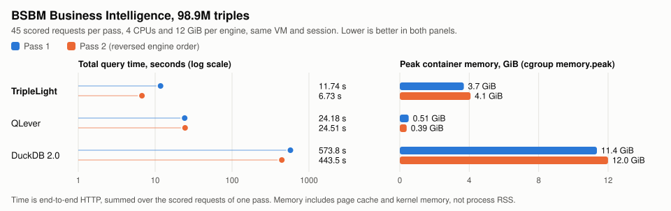

# TripleLight

**An embedded, analytical RDF database with SPARQL 1.1, written in Rust.**

TripleLight is aimed at RDF analytics the way DuckDB is aimed at tables: aggregates, GROUP BY, DISTINCT and
large joins over millions to hundreds of millions of triples. You can use it as:

- a **library** inside your Rust or Python program, with no server to run, or
- a **SPARQL 1.1 HTTP server**, from one command.

Data lives in memory or in a persistent on-disk store with a write-ahead log. Benchmark answers are checked
against Apache Jena, and SPARQL features TripleLight does not implement are rejected with an "unsupported" error
instead of returning a partial result.

> **Status: early (0.1).** The project was called `rdfdb` until November 2026. The `rdfdb` command and Python
> import still work as aliases, and existing stores open unchanged; Rust code must switch `rdfdb::` imports to
> `triplelight::`. There are no published releases yet; build from source. The on-disk format and APIs may still
> change. Unix only (Linux, macOS), Rust 1.89+.

## Quickstart

### Command line

```sh
git clone https://github.com/odysa/rdfdb.git triplelight && cd triplelight
cargo build --release            # binary: ./target/release/triplelight

# Ask a question of an N-Triples or Turtle file
./target/release/triplelight query data.nt 'SELECT (COUNT(*) AS ?n) WHERE { ?s ?p ?o }'

# Serve it over HTTP (SPARQL 1.1 protocol at http://127.0.0.1:7878/sparql)
./target/release/triplelight serve data.nt 7878

# Persistent store: created from data.nt on first start, accepts SPARQL Update
./target/release/triplelight serve-store ./store 7878 --disk --init data.nt
```

Query the server with any SPARQL client, for example:

```sh
curl -s http://127.0.0.1:7878/sparql --data-urlencode 'query=SELECT * WHERE { ?s ?p ?o } LIMIT 5'
```

### Python

```sh
python3 -m venv .venv && source .venv/bin/activate    # maturin develop needs an active virtualenv
pip install maturin
cd bindings/python && maturin develop --release
```

```python
import triplelight

db = triplelight.Database("my.db")                  # opens or creates a store in this directory
db.update('INSERT DATA { <urn:alice> <urn:age> 30 . <urn:bob> <urn:age> 41 }')
db.load("more-data.nt")                             # bulk import N-Triples or Turtle

for row in db.query("SELECT ?who ?age WHERE { ?who <urn:age> ?age } ORDER BY ?age"):
    print(row["who"], row["age"])                   # IRIs, ints, strings come back as Python values
```

Updates are atomic and durable (fsync before `update` returns). `db.read()` gives a consistent snapshot for several
queries. See [bindings/python](bindings/python).

### Rust

```toml
[dependencies]
triplelight = { git = "https://github.com/odysa/rdfdb" }
```

```rust
use triplelight::embedded::Database;
use triplelight::exec::QueryResult;

let db = Database::open("./example.db")?;
db.update("INSERT DATA { <https://ex/s> <https://ex/p> <https://ex/o> }")?;
match db.read().query("ASK { <https://ex/s> <https://ex/p> <https://ex/o> }")? {
    QueryResult::Boolean(found) => assert!(found),
    _ => unreachable!(),
}
```

More in [docs/embedded/README.md](docs/embedded/README.md), including bulk loading of large files with
`triplelight build-disk`.

## Performance

Two analytical workloads, each measured in its own session on one Linux VM, with every engine capped at 4 CPUs and
12 GiB. They were not measured together on one build: BI used rdfdb commit `ef7a778` and the aggregate suite
`9a2f49b`.
Left: total query time in **seconds, log scale**. Right: peak container memory in **GiB**. **Lower is better** in
both. Each engine ran two passes (pass 2 in reversed order); both are shown because timings drift between passes.

<picture>
  <source media="(prefers-color-scheme: dark)" srcset="docs/images/bench-bi100m-dark.svg">
  
</picture>

<picture>
  <source media="(prefers-color-scheme: dark)" srcset="docs/images/bench-aggregate72-dark.svg">
  
</picture>

| Workload | What is timed | Answers checked |
|---|---|---|
| **BSBM BI, 98.9M triples** | 45 requests per pass over 8 query templates, end-to-end HTTP | Against Jena; all engines pass a value-only check, TripleLight and DuckDB also pass the datatype check on 60/60 |
| **Aggregate72** (LUBM-100 13.4M + WatDiv 10.9M triples) | 72 COUNT / GROUP BY / DISTINCT queries per pass, end-to-end HTTP | Against Jena; all engines pass with COUNT `xsd:int` accepted as `xsd:integer` |

**What this shows, honestly:**

- TripleLight is the fastest of these engines on both workloads in total time: about 2–4× QLever on BI at 98.9M
  triples, and about 8–9× QLever and Virtuoso on the aggregate suite.
- **QLever uses much less memory** (about a tenth of TripleLight's on BI 100M) and is faster on one BI query
  template (q3). Memory and q3 are our main open gaps.
- On WatDiv alone, TripleLight and Virtuoso are close (0.26 / 0.23 s vs 0.30 / 0.31 s).
- DuckDB is a SQL baseline over one triples table with hand-written SQL, not a native RDF engine.
- Two passes on a shared machine is a bounded observation, not a significance test.

Full tables, per-query breakdowns, more datasets (LUBM-1000, BSBM, WatDiv), other engines (Jena, RDF4J,
Oxigraph, Virtuoso, LadybugDB), methodology and raw evidence: **[docs/benchmarks.md](docs/benchmarks.md)**.
The charts are generated by [bench/charts.py](bench/charts.py) from the published evidence.

## Features

- **SPARQL 1.1 query and update**: SELECT, ASK, CONSTRUCT, OPTIONAL, UNION, MINUS, FILTER, EXISTS, subqueries,
  VALUES, BIND, GROUP BY with all standard aggregates, ORDER BY, LIMIT/OFFSET, `INSERT DATA`, `DELETE DATA`,
  `DELETE/INSERT WHERE`.
- **Exact numbers, within a range**: `xsd:decimal` arithmetic is exact within 96 bits and 28 fractional digits, and
  `xsd:integer` within 64 bits; results outside that range are query errors (Jena uses arbitrary precision).
  Non-terminating decimal quotients such as 1/3 are rounded to 28 digits. Decimal underflow is an error, which is
  stricter than XPath (XPath returns 0.0), so numeric behavior is not fully SPARQL-conformant.
- **Storage**: dictionary-encoded 64-bit term IDs, six sorted triple orders, compressed and checksummed blocks
  with a shared cache, write-ahead log with group commit, snapshot reads, and compaction.
- **Query engine**: cost-based join ordering from statistics, worst-case-optimal (leapfrog) and bind joins,
  filter pushdown, hash aggregation and top-k on term IDs.
- **W3C SPARQL 1.1 test suite**: 281 pass, 6 fail, 44 unsupported ([details](bench/results/w3c-sparql11)).

### Not supported yet

- Property paths, named graphs (`GRAPH`, `FROM`, N-Quads/TriG), `SERVICE`, `DESCRIBE`, and some functions (hashes, `NOW`,
  `UUID`, …). These return an "unsupported" error.
- Results are fully materialized in memory; there is no streaming or Arrow output yet.
- One process per store directory (enforced by a file lock). The HTTP server has no authentication on updates
  and binds to 127.0.0.1 by default.
- Opening a large store takes seconds until optimizer statistics are ready (42.8 s for a 100M-triple store);
  queries work before that with simpler plans.

## Learn more

- [DESIGN.md](DESIGN.md) and [docs/design/first-principles.md](docs/design/first-principles.md): architecture and
  design rationale
- [docs/benchmarks.md](docs/benchmarks.md): all benchmark results and how to read them
- [docs/embedded/README.md](docs/embedded/README.md): Rust API and bulk loading
- [docs/](docs/): optimizer, storage and benchmark reports

## License

No license has been chosen yet. Until one is added, the code is not licensed for reuse.
